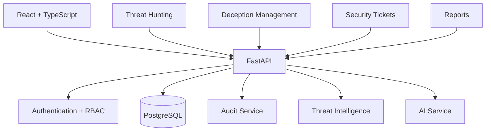
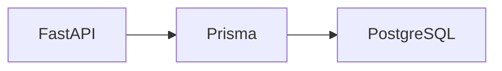
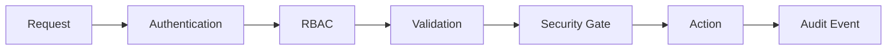
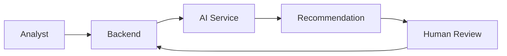

# Architecture

### RabbitHollow

RabbitHollow bude rozdělený na frontend, backend, persistence a řízené integrační vrstvy. UI z původního prototypu zůstává hlavním zdrojem požadavků na workflow.

## Přehled



## Frontend

Frontend bude implementovaný v React + TypeScript + Vite.

Odpovědnosti:

- rendering views
- navigation
- local UI state
- API communication
- form validation
- permission-aware UI
- loading/error states
- responsive layout

Frontend není security boundary. Veškerá authorization a bezpečnostní validace musí probíhat také na backendu.

Doporučená struktura:

```text
frontend/
  src/
    components/
    features/
    layouts/
    pages/
    hooks/
    services/
    types/
    utils/
```

## Backend

Backend bude postavený na FastAPI.

Odpovědnosti:

- REST API
- authentication
- authorization
- business logic
- request validation
- security gates
- audit events
- AI orchestration
- integration boundaries

Doporučená struktura:

```text
backend/
  app/
    api/
    core/
    models/
    schemas/
    services/
    security/
    integrations/
    tests/
```

API endpointy nebudou obsahovat rozsáhlou business logiku. Ta bude oddělená v service vrstvě.

## Database

PostgreSQL bude source of truth pro persistentní aplikační data.

Prisma bude použita jako ORM a schema source pro databázové modely.



Database schema bude verzované přes migrations. Seed data budou určena pouze pro development a test prostředí.

## Domain boundaries

Hlavní domény:

```text
Identity
Deception
Events
Intelligence
Attackers
Tickets
Audit
AI
Reports
Settings
```

Každá doména má mít jasnou odpovědnost a nemá obcházet vlastní service/API boundary přímým přístupem do cizí business logiky.

## Security boundary

Citlivé operace procházejí následujícím tokem:



Frontend může akci nabídnout, ale backend rozhoduje, zda je povolená.

High-risk deception deployment bude vyžadovat explicitní approval workflow.

## AI boundary

AI nebude součástí bezpečnostní hranice jako autorita. Bude fungovat jako řízená service vrstva.



AI nemá v MVP přímý shell, firewall nebo production deployment access.

## Audit

Citlivé operace vytvoří audit event v rámci stejného backendového workflow.

Audit musí být append-only z pohledu běžného uživatele a musí obsahovat correlation ID pro propojení souvisejících akcí.

## Deployment boundary

První MVP oddělí aplikační workflow od skutečného deploymentu deception infrastruktury. Nejdříve bude implementována bezpečná konfigurace, validace, approval a audit.

Skutečné network/deception deployment operace budou přidávány až po ověření bezpečnostního modelu.

## Source of truth

Původní `rabbithollow-v3_4.html` je reference pro UI, views a workflow.

`MVP_PLAN.md` definuje pořadí implementace.

`DATA_MODEL.md` definuje persistentní doménový model.

`API.md` definuje veřejný backend contract.
