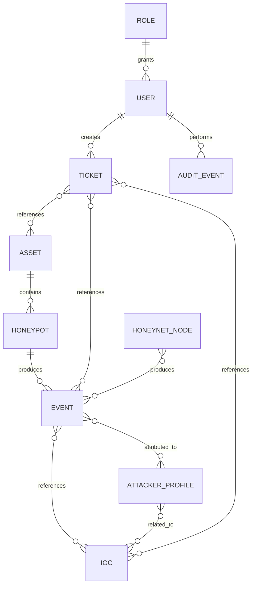

# Data Model

### RabbitHollow

Datový model vychází z workflow současného RabbitHollow prototypu a je navržený tak, aby jednotlivé security objekty šly mezi sebou korelovat.

## Entity

## User

Identita uživatele platformy.

Minimálně:

- id
- email/username
- display name
- password hash nebo identity provider reference
- role ID
- status
- createdAt
- updatedAt

Hesla se nikdy neukládají v plaintextu.

## Role

RBAC role a jejich oprávnění.

Role musí být vyhodnocována server-side.

## Asset

Evidence produkčních a deception assets.

Minimálně:

- id
- name
- asset type
- environment
- IP/hostname
- status
- owner
- metadata
- timestamps

Produkční credentials nejsou součástí asset metadata.

## Honeypot

Konfigurace deception node.

Minimálně:

- id
- asset ID
- node name
- IP
- port
- service type
- banner
- configuration
- status
- risk level
- deployment state
- createdBy
- timestamps

High-risk deployment musí mít approval state.

## Honeynet Node

Node používaný v honeynet topology.

Minimálně:

- id
- name
- node type
- network segment
- VLAN/subnet
- isolation state
- metadata

Topology relationships mohou být řešeny samostatnou relation tabulkou.

## Event

Centrální security event pro korelaci aktivit.

Minimálně:

- id
- timestamp
- event type
- source
- source IP
- destination
- honeypot ID
- honeynet node ID
- severity
- raw metadata
- correlation ID

Na `timestamp`, `source IP`, `event type` a correlation atributy budou podle usage vytvořeny indexy.

## IOC

Indicator of compromise.

Podporované typy z UI:

- IP
- domain
- hash
- URL
- other

Minimálně:

- id
- type
- value
- normalized value
- severity
- risk
- source
- firstSeen
- lastSeen
- metadata

Citlivé hodnoty musí být vhodně normalizované a validované.

## Attacker Profile

Behaviorální profil vytvořený korelací eventů.

Minimálně:

- id
- identifier
- risk score
- firstSeen
- lastSeen
- observed services
- techniques
- metadata

IP adresa nebude jediným identity atributem profilu.

## Ticket

Security incident a investigation workflow.

Minimálně:

- id
- title
- description
- severity
- status
- assigned user
- createdBy
- timestamps

Vztahy na eventy, IOCs, attackery a assets budou řešeny relation tabulkami.

## Audit Event

Neměnný záznam důležité akce.

Minimálně:

- id
- timestamp
- actor ID
- action
- resource type
- resource ID
- result
- metadata
- correlation ID

Běžný uživatel nesmí audit event aktualizovat ani mazat.

## Indexing

První indexy:

| Entity | Index |
| --- | --- |
| User | email/username |
| Event | timestamp |
| Event | source IP + timestamp |
| Event | event type + timestamp |
| IOC | normalized value |
| IOC | type + severity |
| AttackerProfile | risk score |
| Ticket | status + severity |
| AuditEvent | timestamp |
| AuditEvent | correlation ID |

Indexy budou upraveny podle skutečného query patternu po implementaci API.

## Data lifecycle

Eventy a audit log mají odlišný lifecycle od běžných aplikačních entit.

- configuration data lze aktualizovat podle permission modelu
- event data jsou po ingestu primárně immutable
- audit events jsou append-only
- ticket může mít řízené status transitions
- AI-generated data musí být označena jako AI output

## Seed data

Development seed může obsahovat pouze syntetická data.

Nebudou použity skutečné credentials, API keys, production IPs ani reálné PII.
