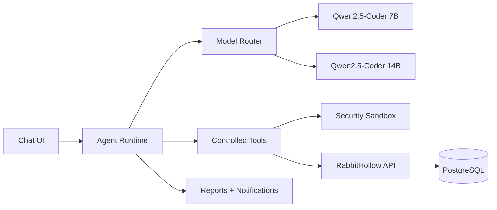

# RabbitHollow LLM Agent

### Qwen2.5-Coder 7B → 14B → Autonomous Security Agent

> Plán pro integraci lokálního LLM chatbotu a postupný vývoj bezpečného AI agenta přímo do RabbitHollow.

## 🎯 Cíl

RabbitHollow dostane vlastní AI vrstvu, která bude dostupná přímo v platformě a bude pracovat s kontextem aktuálního security prostředí.

První produkční integrační model bude **Qwen2.5-Coder 7B**. Model **Qwen2.5-Coder 14B už byl samostatně spuštěn a ověřen na localhostu**, takže jeho pozdější integrace nebude začínat od ověřování samotného LLM runtime.

Dlouhodobým cílem není pouze chatbot. AI má postupně vyrůst v bezpečného **autonomous security agent**, který dokáže průběžně vyhodnocovat stav prostředí, pracovat s bezpečnostními nástroji v izolovaném sandboxu, reagovat na detekovaná rizika a připravovat pravidelné security reports.

Autonomie bude přidávána postupně. Každá nová úroveň schopností musí mít vlastní permission model, sandbox boundaries, audit a možnost human override.

## 🧠 Model strategy



### Qwen2.5-Coder 7B

Použije se jako výchozí lokální model pro:

- chat
- code-aware reasoning
- security event analysis
- IOC analysis
- query assistance
- ticket drafting
- report assistance
- structured tool calling

Výhodou je nižší hardware náročnost a rychlejší inference.

### Qwen2.5-Coder 14B

14B už prošel prvním samostatným spuštěním na localhostu. Jeho integrace do RabbitHollow přijde až po stabilizaci 7B AI stacku.

Použití:

- složitější investigation
- delší context
- komplexnější correlation
- kvalitnější report generation
- komplexnější agent workflows

Frontend ani API contract se kvůli tomu nemá měnit. Model selection musí být řešená interně přes model router.

## 🏗️ Doporučená architektura

LLM nemá být přímo součástí React aplikace.

Doporučený tok:

```text
React Chat UI
      ↓
FastAPI /api/ai/chat
      ↓
Agent Runtime
      ↓
Context Builder
      ↓
Policy Engine
      ↓
Model Router
      ↓
Local LLM Runtime
      ↓
Qwen2.5-Coder 7B / 14B
```

Agent Runtime bude mít oddělené vrstvy:

```text
AI API
├── conversation service
├── context builder
├── model router
├── agent runtime
├── tool registry
├── tool authorization
├── policy engine
├── memory service
├── prompt management
├── sandbox controller
└── audit service
```

## ⚙️ LLM runtime

Pro lokální deployment je doporučený **llama.cpp** s `llama-server` a GGUF modely.

Důvod:

- lokální inference
- OpenAI-compatible HTTP API
- GGUF support
- možnost CPU/GPU offloadu
- jednoduché oddělení model runtime od FastAPI
- možnost později vyměnit model bez změny aplikace

RabbitHollow backend bude komunikovat s LLM přes interní HTTP API. Model runtime nebude přímo přístupný z browseru.

Ověřený základ pro 14B už existuje:

```text
Local client
    ↓
localhost
    ↓
llama-server
    ↓
Qwen2.5-Coder 14B GGUF
```

Tento ověřený runtime později pouze zapojíme za stejný backend adapter, který bude používat 7B.

Příklad cílového rozložení:

```text
Browser
  ↓
Frontend :5173
  ↓
FastAPI :8000
  ↓
llama-server :8080
```

Port `8080` musí být dostupný pouze z důvěryhodného lokálního/internal network contextu.

## 💬 Chat

Chat UI bude součástí RabbitHollow interface a musí respektovat současný vizuální systém.

Základní funkce:

- streaming odpovědi
- conversation history
- nový chat
- pokračování konverzace
- stop generation
- retry
- copy response
- clear conversation
- model indicator
- tool activity indicator
- error state

Chat musí podporovat structured messages místo ukládání pouze jednoho dlouhého prompt stringu.

## 🧩 Context management

Agent nesmí automaticky posílat celou databázi do modelu.

Context Builder vybere pouze relevantní data podle dotazu.

Příklad:

```text
User question
    ↓
Intent detection
    ↓
Relevant resources
    ↓
Authorization check
    ↓
Context filtering
    ↓
Prompt / tool input
```

Pro security data je důležité:

- respektovat RBAC
- filtrovat secrets
- filtrovat production credentials
- minimalizovat context
- používat correlation IDs
- auditovat citlivé tool calls

## 🧠 Memory

Memory bude rozdělena na několik vrstev.

### Conversation memory

Historie aktuálního chatu.

### User memory

Pouze bezpečné preference a pracovní context, které uživatel skutečně potřebuje.

### Investigation memory

Context konkrétního incidentu nebo investigation.

### Long-term knowledge

Později může být přidána knowledge base / RAG vrstva pro interní dokumentaci, detection rules a security knowledge.

Memory nesmí obcházet authorization. To, že model něco jednou viděl, neznamená, že k tomu má mít uživatel později přístup.

## 🛠️ Agent tools

Agent bude používat controlled tools namísto přímého přístupu k databázi nebo systému.

První sada:

```text
searchEvents
getEvent
searchIOCs
getIOC
searchAttackerProfiles
getAttackerProfile
searchIPActivity
getAsset
getHoneypot
searchTickets
getTicket
createTicketDraft
createReportDraft
runThreatQuery
```

Tools musí mít:

- explicitní schema
- input validation
- authorization
- timeout
- rate limit
- audit event
- safe error handling

Agent nesmí dostat obecný SQL executor jako náhradu za controlled tools.

## 🔐 Tool permissions

Každý tool bude mít permission level.

| Level | Příklad | AI může provést |
| --- | --- | --- |
| Read | `searchEvents` | Ano |
| Analysis | `runThreatQuery` | Ano, s limity |
| Draft | `createTicketDraft` | Ano |
| Approval | security-sensitive action | Ne bez člověka |
| Execution | deployment/firewall/shell | Ne v MVP |

Tohle oddělení je zásadní. Agent není root user.

## 🧪 Budoucnost: Security Sandbox

Dlouhodobě bude agent dostávat vlastní izolovaný **security sandbox**.

Sandbox bude určený pro bezpečné používání obranných cybersecurity nástrojů, které budou provozované v samostatných kontejnerech.

```text
AI Agent
   ↓
Policy Engine
   ↓
Sandbox Controller
   ↓
Container Runtime
   ├── defensive scanner
   ├── log analysis tool
   ├── IOC analysis tool
   ├── network diagnostics
   └── other approved security tools
```

Jednotlivé kontejnery musí být:

- izolované od host systému
- omezené network access
- omezené filesystem access
- omezené CPU/RAM
- časově omezené
- monitorované
- auditované
- spouštěné pouze přes allowlist

Agent nebude dostávat možnost libovolně spouštět Docker commands nebo vytvářet vlastní privileged containers.

Sandbox slouží k **defensive security analysis**, ne jako cesta k obcházení bezpečnostních hranic host systému.

## 🖥️ Terminal access

Pokud to bude možné bezpečně implementovat, agent získá v budoucí fázi **terminal access pouze uvnitř sandboxu**.

Princip:

```text
Agent
  ↓
Command Policy
  ↓
Sandbox Terminal
  ↓
Ephemeral Container
```

Terminal nesmí být přímý shell hostitele.

Každý command bude před spuštěním procházet policy kontrolou. Výstup bude vrácen agentovi jako nedůvěryhodná tool data a bude auditovaný.

Preferovaný model je ephemeral session:

```text
create sandbox
    ↓
run approved command
    ↓
collect output
    ↓
store audit metadata
    ↓
destroy sandbox
```

Pokud nebude možné zajistit dostatečně silnou izolaci, terminal access nebude aktivován.

## 🤖 Autonomní security monitoring

Dlouhodobým cílem je, aby agent nemusel čekat pouze na otázku uživatele.

Agent může pravidelně vyhodnocovat:

- security events
- IOC activity
- attacker activity
- honeypot activity
- anomaly signals
- asset status
- detection results
- open security tickets

Z toho bude vytvářet bezpečnostní stav prostředí.

```text
Telemetry
   ↓
Detection
   ↓
Correlation
   ↓
Risk Assessment
   ↓
Agent Decision
   ↓
Policy Check
   ↓
Response / Escalation
```

Autonomní reakce musí mít několik úrovní.

### Level 0 — Observe

Agent pouze sleduje a vyhodnocuje.

### Level 1 — Recommend

Agent vytvoří doporučení a upozornění.

### Level 2 — Prepare

Agent připraví ticket, report, query nebo návrh bezpečnostního opatření.

### Level 3 — Controlled response

Agent může provést předem schválenou low-risk akci v sandboxu nebo jiném explicitně autorizovaném prostředí.

### Level 4 — Autonomous response

Pouze pro přesně definované a otestované scénáře s možností rollbacku, auditováním a emergency kill switchem.

High-risk actions zůstávají za human approval.

## 🚨 Risk evaluation

Agent bude mít vlastní risk assessment pipeline.

```text
Events
  ↓
Normalization
  ↓
Correlation
  ↓
Severity
  ↓
Confidence
  ↓
Impact
  ↓
Risk Score
  ↓
Response Policy
```

Model nesmí být jediným zdrojem rozhodnutí. Kritická rozhodnutí musí být kombinací:

- deterministic rules
- trusted telemetry
- authorization policy
- model reasoning
- confidence threshold

LLM může doporučit akci, ale policy engine rozhodne, zda je akce vůbec povolená.

## 📋 Automated reports

Agent bude později vytvářet pravidelné security reports automaticky.

Typy:

- daily security summary
- weekly security report
- incident report
- IOC report
- honeypot activity report
- attacker activity report
- risk trend report
- executive summary

Workflow:

```text
Scheduled Job
      ↓
Collect Security Data
      ↓
Analyze
      ↓
Generate Report
      ↓
Validate
      ↓
Store Report
      ↓
Notify Users
```

Report musí obsahovat zdrojová data nebo odkazy na relevantní RabbitHollow entities, aby byl výsledek dohledatelný.

## 🔔 Notifications

Po vytvoření reportu může agent prostřednictvím notification service informovat uživatele.

Možné kanály podle budoucí konfigurace:

- in-app notification
- email
- další schválené notification providers

Notification service nesmí být přímou schopností LLM. Agent pouze vytvoří strukturovaný notification request a backend ověří oprávnění a cílové uživatele.

Uživatel si bude moci nastavit:

- typ reportů
- frekvenci
- severity threshold
- notification channel
- čas doručení

## 🔁 Autonomous agent loop

Dlouhodobý cílový loop:

```text
Observe
   ↓
Understand
   ↓
Correlate
   ↓
Assess risk
   ↓
Choose action
   ↓
Policy check
   ↓
Execute / Recommend
   ↓
Verify result
   ↓
Audit
   ↓
Report
   ↓
Observe again
```

Agent musí být schopen ověřit výsledek vlastní akce. Nesmí považovat samotné úspěšné zavolání toolu za důkaz, že problém byl vyřešen.

## 🛑 Emergency controls

Autonomní režim musí mít bezpečnostní pojistky:

- global AI kill switch
- sandbox kill switch
- per-tool disable
- per-agent disable
- maximum tool calls per run
- maximum runtime
- resource limits
- network egress policy
- approval gates
- rollback where possible
- complete audit trail

Pokud policy engine nebo sandbox controller není dostupný, agent musí přejít do safe failure mode a pouze informovat uživatele.

## 🚫 Co agent nesmí dělat

Bez explicitního rozšíření permission modelu:

- spouštět shell commands na hostiteli
- získávat host root access
- spouštět privileged containers
- používat arbitrary SQL
- měnit firewall rules přímo
- provádět production deployment
- mazat security data
- měnit RBAC
- číst secrets
- získávat production credentials
- provádět high-risk containment bez human approval

## 🛡️ Prompt security

Prompt musí být sestavený z oddělených částí:

```text
system policy
↓
security policy
↓
user context
↓
trusted application context
↓
tool results
↓
user message
```

Externí data, IOC values, honeypot payloads nebo attacker-controlled text nesmí být automaticky považovány za instructions.

Agent musí rozlišovat mezi:

- trusted system instructions
- trusted application data
- untrusted external data
- user input

To je důležité zejména proti prompt injection z honeypot session dat.

## 🔄 Model routing

Model router musí abstrahovat konkrétní model.

```ts
interface ModelConfig {
  id: string;
  endpoint: string;
  contextWindow: number;
  capabilities: string[];
}
```

Příklad logiky:

```text
simple chat        → 7B
IOC lookup         → 7B
query assistance   → 7B
basic triage       → 7B

complex analysis   → 14B
long investigation → 14B
complex report     → 14B
```

Routing může být nejprve manuální přes konfiguraci a později automatizovaný podle complexity score.

## 📡 Streaming

Chat odpovědi budou streamované z LLM runtime přes backend k browseru.

Preferovaný tok:

```text
llama-server
    ↓ streaming
FastAPI
    ↓ SSE
React
```

FastAPI zůstává prostředníkem, aby browser nikdy nemusel znát interní model endpoint.

Později lze podle potřeby přejít na WebSocket pro komplexnější agent events.

## 🗃️ Database

Chat a agent workflow budou persistentní.

Základní entity:

```text
Conversation
Message
AgentRun
ToolCall
ModelRun
AgentSchedule
SecurityReport
Notification
```

Důležité vazby:

```text
User
 ↓
Conversation
 ↓
Message
 ↓
AgentRun
 ↓
ToolCall
 ↓
AuditEvent
```

Do databáze se nemají ukládat celé citlivé prompt contexty automaticky. Retention policy bude řešena podle typu dat.

## 🧪 Evaluation

Před aktivním používáním agenta musí existovat testovací sada.

Testy musí pokrývat:

- správnost tool selection
- hallucination resistance
- prompt injection resistance
- authorization boundaries
- IOC analysis
- event correlation
- ticket drafting
- structured output
- malformed tool arguments
- long context
- empty results
- conflicting data
- timeout
- model failure
- sandbox escape attempts
- command policy enforcement
- resource exhaustion
- autonomous response safety

Stejný evaluation dataset se použije pro 7B i 14B, aby bylo možné porovnat kvalitu.

## 🚀 Deployment postup

### Fáze 1 — Ověřený local runtime

**14B už tuto fázi absolvoval.**

1. GGUF model byl lokálně připraven.
2. `llama-server` byl spuštěn.
3. Localhost inference byla ověřena.
4. OpenAI-compatible runtime je ověřený základ pro další integraci.

Pro 7B se stejný postup zopakuje s cílem připravit hlavní MVP model.

### Fáze 2 — Backend adapter

FastAPI dostane izolovanou `llm` service vrstvu.

```text
api
 ↓
ai service
 ↓
llm provider
 ↓
llama-server
```

Frontend nebude znát model endpoint.

### Fáze 3 — Chat

Přidat:

- conversation API
- streaming
- message persistence
- cancellation
- error handling
- chat UI

### Fáze 4 — Agent runtime

Přidat:

- tool registry
- tool schemas
- authorization
- context builder
- agent loop
- audit
- rate limiting
- policy engine

### Fáze 5 — RabbitHollow context

Napojit pouze read-only controlled tools:

- events
- IOCs
- IP activity
- attacker profiles
- assets
- tickets

### Fáze 6 — Security hardening

Otestovat:

- prompt injection
- tool injection
- authorization bypass
- data leakage
- excessive tool calls
- malformed outputs
- denial of service
- context poisoning

### Fáze 7 — 14B integration

Po stabilizaci 7B:

1. Zapojit už ověřený Qwen2.5-Coder 14B runtime přes stejný `llm` adapter.
2. Přidat model configuration.
3. Otestovat inference performance v rámci aplikace.
4. Spustit stejný evaluation dataset.
5. Porovnat 7B vs 14B.
6. Přidat model routing.
7. Zachovat stejný frontend a API contract.

### Fáze 8 — Sandbox

Po stabilizaci read-only agenta:

1. Přidat sandbox controller.
2. Přidat containerized defensive tools.
3. Zavést resource limits.
4. Zavést network egress policy.
5. Zavést command/tool allowlist.
6. Přidat ephemeral sandbox sessions.
7. Přidat sandbox escape testing.
8. Teprve poté experimentovat s terminal access.

### Fáze 9 — Autonomous monitoring

1. Přidat scheduled observation jobs.
2. Přidat risk assessment pipeline.
3. Přidat deterministic response policies.
4. Přidat automated report generation.
5. Přidat notification service.
6. Zavést autonomy levels.
7. Povolit pouze nízkorizikové autonomní reakce.
8. Přidat human approval pro vyšší riziko.

## 📊 Observability

Každý agent run bude mít:

- `runId`
- `conversationId`
- `modelId`
- latency
- token usage, pokud runtime poskytuje metadata
- tool calls
- sandbox session ID, pokud existuje
- result status
- error information
- policy decisions

Do logů se nesmí zapisovat secrets nebo celé citlivé contexty.

## ⚡ Performance

7B bude výchozí model kvůli rychlosti a hardware nárokům.

Pro lokální inference je potřeba měřit:

- time to first token
- tokens per second
- context processing time
- VRAM/RAM usage
- CPU usage
- concurrent requests

14B už má ověřenou základní local inference. Před jeho integrací do routingu se ale musí změřit výkon přímo v RabbitHollow workflow.

Sandbox bude navíc měřit:

- container startup time
- command execution time
- CPU/RAM usage
- network traffic
- failed policy checks
- sandbox termination events

## 🧱 Definition of Done

LLM MVP je hotové, když:

- RabbitHollow obsahuje integrovaný chat
- Qwen2.5-Coder 7B běží lokálně
- frontend nikdy nepřistupuje přímo k LLM runtime
- odpovědi jsou streamované
- conversations jsou persistentní
- agent má controlled tools
- každý tool respektuje RBAC
- tool calls jsou auditované
- secrets nejsou součástí AI contextu
- prompt injection z nedůvěryhodných dat je ošetřený
- AI nemá shell, firewall ani production deployment access
- existuje evaluation suite
- již ověřený 14B lze přidat přes stejný model adapter/router

## 🔭 Budoucí AI roadmap

```text
Qwen2.5-Coder 7B
        ↓
Integrated Chat
        ↓
Controlled Agent
        ↓
Qwen2.5-Coder 14B
        ↓
RAG + Security Knowledge
        ↓
Sandboxed Security Tools
        ↓
Sandbox Terminal
        ↓
Continuous Security Monitoring
        ↓
Autonomous Risk Assessment
        ↓
Controlled Autonomous Response
        ↓
Automated Security Reports
        ↓
User Notifications
        ↓
Adaptive Security Agent
```

Konečným cílem je vytvořit AI bezpečnostního analytika, který dokáže **nepřetržitě sledovat security stav RabbitHollow prostředí, rozumět souvislostem mezi událostmi, bezpečně používat dostupné obranné nástroje, vyhodnocovat rizika, navrhovat nebo provádět povolené reakce a pravidelně informovat uživatele o stavu prostředí**.

Autonomie ale nesmí znamenat nekontrolovaný přístup. Každé rozšíření schopností musí být doprovázeno izolací, policy enforcementem, auditováním, resource limits, rollback mechanismem tam, kde je možný, a jasně definovanou hranicí mezi doporučením a skutečnou akcí.

## Pozdější rozšíření

Po stabilizaci MVP lze přidat:

- RAG nad interní security knowledge base
- semantic search
- automatic model routing
- background investigation jobs
- multi-agent workflows
- local embeddings
- model performance dashboard
- offline evaluation pipeline
- další lokální model providers
- sandbox orchestration
- automated security reports
- notification workflows
- continuous security monitoring
- controlled autonomous response
