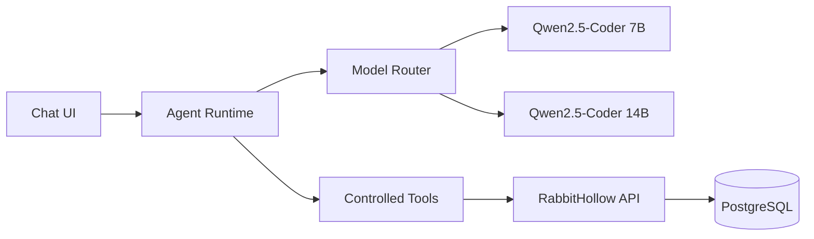

# RabbitHollow LLM Agent

### Qwen2.5-Coder 7B → 14B

> Plán pro integraci lokálního LLM chatbotu a bezpečného AI agenta přímo do RabbitHollow.

## 🎯 Cíl

RabbitHollow dostane vlastní AI vrstvu, která bude dostupná přímo v platformě a bude pracovat s kontextem aktuálního security prostředí.

První model bude **Qwen2.5-Coder 7B**. Po stabilizaci celé AI vrstvy bude možné přidat silnější **Qwen2.5-Coder 14B** bez změny frontendového chat interface a bez přepisování agent architecture.

AI nebude pouze samostatný chatbot. Cílem je agent schopný bezpečně pracovat s RabbitHollow daty, nástroji a workflow.

## 🧠 Model strategy



### Qwen2.5-Coder 7B

Použije se jako výchozí lokální model pro:

- chat
- code-aware reasoning
- security event analysis
- IOC analysis
- query assistance
- ticket drafting
- report assistance
- structured tool calling

Výhodou je nižší hardware náročnost a rychlejší inference.

### Qwen2.5-Coder 14B

14B bude přidán jako druhý model až po stabilizaci 7B stacku.

Použití:

- složitější investigation
- delší context
- komplexnější correlation
- kvalitnější report generation
- komplexnější agent workflows

Frontend ani API contract se kvůli tomu nemá měnit. Model selection musí být řešená interně přes model router.

## 🏗️ Doporučená architektura

LLM nemá být přímo součástí React aplikace.

Doporučený tok:

```text
React Chat UI
      ↓
FastAPI /api/ai/chat
      ↓
Agent Runtime
      ↓
Context Builder
      ↓
Model Router
      ↓
Local LLM Runtime
      ↓
Qwen2.5-Coder 7B / 14B
```

Agent Runtime bude mít oddělené vrstvy:

```text
AI API
├── conversation service
├── context builder
├── model router
├── agent runtime
├── tool registry
├── tool authorization
├── memory service
├── prompt management
└── audit service
```

## ⚙️ LLM runtime

Pro lokální deployment je doporučený **llama.cpp** s `llama-server` a GGUF modely.

Důvod:

- lokální inference
- OpenAI-compatible HTTP API
- GGUF support
- možnost CPU/GPU offloadu
- jednoduché oddělení model runtime od FastAPI
- možnost později vyměnit model bez změny aplikace

RabbitHollow backend bude komunikovat s LLM přes interní HTTP API. Model runtime nebude přímo přístupný z browseru.

Příklad interního rozložení:

```text
Browser
  ↓
Frontend :5173
  ↓
FastAPI :8000
  ↓
llama-server :8080
```

Port `8080` musí být dostupný pouze z důvěryhodného lokálního/internal network contextu.

## 💬 Chat

Chat UI bude součástí RabbitHollow interface a musí respektovat současný vizuální systém.

Základní funkce:

- streaming odpovědi
- conversation history
- nový chat
- pokračování konverzace
- stop generation
- retry
- copy response
- clear conversation
- model indicator
- tool activity indicator
- error state

Chat musí podporovat structured messages místo ukládání pouze jednoho dlouhého prompt stringu.

## 🧩 Context management

Agent nesmí automaticky posílat celou databázi do modelu.

Context Builder vybere pouze relevantní data podle dotazu.

Příklad:

```text
User question
    ↓
Intent detection
    ↓
Relevant resources
    ↓
Authorization check
    ↓
Context filtering
    ↓
Prompt / tool input
```

Pro security data je důležité:

- respektovat RBAC
- filtrovat secrets
- filtrovat production credentials
- minimalizovat context
- používat correlation IDs
- auditovat citlivé tool calls

## 🧠 Memory

Memory bude rozdělena na několik vrstev.

### Conversation memory

Historie aktuálního chatu.

### User memory

Pouze bezpečné preference a pracovní context, které uživatel skutečně potřebuje.

### Investigation memory

Context konkrétního incidentu nebo investigation.

### Long-term knowledge

Později může být přidána knowledge base / RAG vrstva pro interní dokumentaci, detection rules a security knowledge.

Memory nesmí obcházet authorization. To, že model něco jednou viděl, neznamená, že k tomu má mít uživatel později přístup.

## 🛠️ Agent tools

Agent bude používat controlled tools namísto přímého přístupu k databázi nebo systému.

První sada:

```text
searchEvents
getEvent
searchIOCs
getIOC
searchAttackerProfiles
getAttackerProfile
searchIPActivity
getAsset
getHoneypot
searchTickets
getTicket
createTicketDraft
createReportDraft
runThreatQuery
```

Tools musí mít:

- explicitní schema
- input validation
- authorization
- timeout
- rate limit
- audit event
- safe error handling

Agent nesmí dostat obecný SQL executor jako náhradu za controlled tools.

## 🔐 Tool permissions

Každý tool bude mít permission level.

| Level | Příklad | AI může provést |
| --- | --- | --- |
| Read | `searchEvents` | Ano |
| Analysis | `runThreatQuery` | Ano, s limity |
| Draft | `createTicketDraft` | Ano |
| Approval | security-sensitive action | Ne bez člověka |
| Execution | deployment/firewall/shell | Ne v MVP |

Tohle oddělení je zásadní. Agent není root user.

## 🚫 Co agent nesmí dělat

V první verzi:

- spouštět shell commands
- spouštět arbitrary SQL
- měnit firewall rules
- provádět production deployment
- mazat security data
- měnit RBAC
- číst secrets
- získávat production credentials
- provádět containment bez human approval

AI může navrhnout akci a připravit draft. Kritická akce musí projít backendovým authorization a approval workflow.

## 🛡️ Prompt security

Prompt musí být sestavený z oddělených částí:

```text
system policy
↓
security policy
↓
user context
↓
tool results
↓
user message
```

Externí data, IOC values, honeypot payloads nebo attacker-controlled text nesmí být automaticky považovány za instructions.

Agent musí rozlišovat mezi:

- trusted system instructions
- trusted application data
- untrusted external data
- user input

To je důležité zejména proti prompt injection z honeypot session dat.

## 🔄 Model routing

Model router musí abstrahovat konkrétní model.

```ts
interface ModelConfig {
  id: string;
  endpoint: string;
  contextWindow: number;
  capabilities: string[];
}
```

Příklad logiky:

```text
simple chat       → 7B
IOC lookup        → 7B
query assistance  → 7B
basic triage      → 7B

complex analysis  → 14B
long investigation → 14B
complex report    → 14B
```

Routing může být nejprve manuální přes konfiguraci a později automatizovaný podle complexity score.

## 📡 Streaming

Chat odpovědi budou streamované z LLM runtime přes backend k browseru.

Preferovaný tok:

```text
llama-server
    ↓ streaming
FastAPI
    ↓ SSE
React
```

FastAPI zůstává prostředníkem, aby browser nikdy nemusel znát interní model endpoint.

Později lze podle potřeby přejít na WebSocket pro komplexnější agent events.

## 🗃️ Database

Chat a agent workflow budou persistentní.

Základní entity:

```text
Conversation
Message
AgentRun
ToolCall
ModelRun
```

Důležité vazby:

```text
User
 ↓
Conversation
 ↓
Message
 ↓
AgentRun
 ↓
ToolCall
 ↓
AuditEvent
```

Do databáze se nemají ukládat celé citlivé prompt contexty automaticky. Retention policy bude řešena podle typu dat.

## 🧪 Evaluation

Před přechodem ze 7B na 14B musí existovat testovací sada.

Testy musí pokrývat:

- správnost tool selection
- hallucination resistance
- prompt injection resistance
- authorization boundaries
- IOC analysis
- event correlation
- ticket drafting
- structured output
- malformed tool arguments
- long context
- empty results
- conflicting data
- timeout
- model failure

Stejný evaluation dataset se použije pro 7B i 14B, aby bylo možné porovnat kvalitu.

## 🚀 Deployment postup

### Fáze 1 — Local model

1. Připravit GGUF Qwen2.5-Coder 7B.
2. Spustit `llama-server`.
3. Ověřit OpenAI-compatible API.
4. Otestovat inference mimo RabbitHollow.
5. Nastavit základní model parameters.

### Fáze 2 — Backend adapter

FastAPI dostane izolovanou `llm` service vrstvu.

```text
api
 ↓
ai service
 ↓
llm provider
 ↓
llama-server
```

Frontend nebude znát model endpoint.

### Fáze 3 — Chat

Přidat:

- conversation API
- streaming
- message persistence
- cancellation
- error handling
- chat UI

### Fáze 4 — Agent runtime

Přidat:

- tool registry
- tool schemas
- authorization
- context builder
- agent loop
- audit
- rate limiting

### Fáze 5 — RabbitHollow context

Napojit pouze read-only controlled tools:

- events
- IOCs
- IP activity
- attacker profiles
- assets
- tickets

### Fáze 6 — Security hardening

Otestovat:

- prompt injection
- tool injection
- authorization bypass
- data leakage
- excessive tool calls
- malformed outputs
- denial of service
- context poisoning

### Fáze 7 — 14B

Teprve po stabilizaci 7B:

1. Přidat Qwen2.5-Coder 14B.
2. Přidat model configuration.
3. Otestovat inference performance.
4. Spustit stejný evaluation dataset.
5. Porovnat 7B vs 14B.
6. Přidat model routing.
7. Zachovat stejný frontend a API contract.

## 📊 Observability

Každý agent run bude mít:

- `runId`
- `conversationId`
- `modelId`
- latency
- token usage, pokud runtime poskytuje metadata
- tool calls
- result status
- error information

Do logů se nesmí zapisovat secrets nebo celé citlivé contexty.

## ⚡ Performance

7B bude výchozí model kvůli rychlosti a hardware nárokům.

Pro lokální inference je potřeba měřit:

- time to first token
- tokens per second
- context processing time
- VRAM/RAM usage
- CPU usage
- concurrent requests

14B bude nasazen až po ověření, že hardware a inference runtime poskytují přijatelný výkon.

## 🧱 Definition of Done

LLM MVP je hotové, když:

- RabbitHollow obsahuje integrovaný chat
- Qwen2.5-Coder 7B běží lokálně
- frontend nikdy nepřistupuje přímo k LLM runtime
- odpovědi jsou streamované
- conversations jsou persistentní
- agent má controlled tools
- každý tool respektuje RBAC
- tool calls jsou auditované
- secrets nejsou součástí AI contextu
- prompt injection z nedůvěryhodných dat je ošetřený
- AI nemá shell, firewall ani production deployment access
- existuje evaluation suite
- 14B lze později přidat pouze změnou model configuration/routeru

## Pozdější rozšíření

Po stabilizaci MVP lze přidat:

- RAG nad interní security knowledge base
- semantic search
- automatic model routing
- background investigation jobs
- multi-agent workflows
- local embeddings
- model performance dashboard
- offline evaluation pipeline
- další lokální model providers
