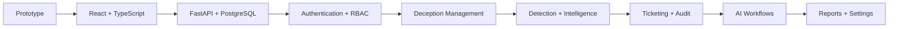

# RabbitHollow MVP

### Deception Intelligence Platform

> Plán převodu současného RabbitHollow prototypu na skutečnou aplikaci bez změny jeho UI konceptu.

## 🎯 MVP cíl

MVP převede současný frontendový prototype na funkční platformu. Stávající views, navigace, workflow a vizuální koncept zůstávají zachované **1:1**.

Mock data a mock actions budou postupně nahrazeny skutečným API, persistentními daty, authentication, RBAC, audit loggingem a controlled security workflows.

## 🧭 Roadmap

## 01 — Frontend foundation

**Cíl:** Převést současný single-page frontend do čisté React + TypeScript aplikace bez vizuální změny.

- React + TypeScript + Vite
- zachování současného UI 1:1
- jednotlivé views jako samostatné components
- společné TypeScript types
- routing a application state
- oddělení UI, state a API logiky
- error handling
- lazy loading views
- základní unit test setup
- responsive behavior pro mobil i 1920×1080

**Výsledek:** React aplikace vizuálně odpovídající původnímu HTML.

## 02 — Backend foundation

**Cíl:** Odstranit závislost na lokální mock logice.

- FastAPI
- PostgreSQL
- Prisma ORM
- migrations
- seed data
- REST API
- request validation
- response schemas
- structured error handling
- základní application logging

Základní doménové modely:

`User` · `Role` · `Asset` · `Honeypot` · `HoneynetNode` · `Event` · `IOC` · `AttackerProfile` · `Ticket` · `AuditEvent`

## 03 — Authentication & RBAC

**Cíl:** Zabezpečit platformu podle role uživatele.

- login
- session/token management
- role-based permissions
- API authorization
- frontend permission checks
- audit citlivých akcí

Bezpečnostní rozhodnutí musí být vždy provedeno také na backendu. Frontend nesmí být security boundary.

## 04 — Dashboard

Dashboard z prototypu bude napojen na skutečná data:

- honeypot status
- intrusion count
- attacker IPs
- IOC count
- risk index
- MITRE ATT&CK coverage
- live event feed
- threat ticker
- global attack origins

Vizualizace zůstávají součástí UI: risk gauge, stat cards, event feed a threat map.

## 05 — Honeypot Builder

Konfigurační workflow vychází přímo z původního builderu.

Podporované service types z prototypu:

`SSH` · `FTP` · `MySQL` · `HTTP` · `RDP` · `SMB` · `SMTP` · `Modbus` · `Kubernetes`

Konfigurace:

- node name
- IP
- port
- service type
- banner
- generated configuration preview
- validation status
- deployment status

High-risk typy jako RDP, SMB, Industrial a Kubernetes vyžadují dual-control approval.

V MVP bude deployment oddělený od samotného UI workflow. Nejprve vznikne bezpečná backendová reprezentace konfigurace a server-side validation.

## 06 — Honeynet Designer

- topology nodes
- network segments
- VLAN/subnet informace
- segment roles
- isolation status
- topology validation
- bezpečné uložení konfigurace

Canvas a současná vizualizace honeynetu zůstávají zachované.

## 07 — Breadcrumb Trails

- lure creation
- lure types
- canarytokens
- activation events
- target tracking
- event timeline

Lure data musí používat synthetic credentials a nesmí obsahovat production secrets nebo reálné PII.

## 08 — Threat Hunting

Podpora workflow, které už existuje v prototypu:

- SPL
- KQL
- Sigma
- SQL
- query validation
- execution nad dostupnými eventy
- query history
- detection rules
- MITRE ATT&CK mapping

MVP nebude předstírat integrace, které nejsou skutečně implementované. Externí SIEM konektory přijdou až po stabilizaci interního event modelu.

## 09 — IOC Intelligence

IOC model musí minimálně podporovat:

- IP address
- domain
- hash
- URL
- IOC type
- severity
- risk
- source
- timestamps
- related events
- search
- filtering

IOC bude možné propojit s IP activity, attacker profiles a tickets.

## 10 — IP Activity Tracker

- IP detail
- event timeline
- honeypot correlation
- time filtering
- IOC correlation
- attacker profile correlation
- activity statistics

IP adresa sama o sobě nebude považována za dostatečný identifikátor útočníka.

## 11 — Attacker Profiles

Z behavioral fingerprint workflow vznikne persistentní profil:

- attacker identifier
- IP history
- observed services
- sessions
- techniques
- related IOCs
- risk score
- timeline

Korelace bude založená na více atributech, nikoliv pouze na IP.

## 12 — Security Tickets

- create ticket
- ticket detail
- severity
- status
- assigned analyst
- investigation notes
- related IP
- related IOC
- related asset
- status transitions
- audit trail

AI může ticket připravit nebo doporučit další postup. Automatické containment akce nejsou součástí prvního MVP.

## 13 — Security & Guardrails

Bezpečnostní koncept z prototypu bude převeden do server-side kontrol:

- RBAC
- deployment validation
- isolation checks
- deny-by-default policy
- synthetic credentials
- honeytoken policy
- dual control
- audit integrity

High-risk deployment nesmí být možné obejít změnou frontendového requestu.

## 14 — Audit Log

Důležité akce vytvářejí append-only audit event.

Event obsahuje minimálně:

| Field | Purpose |
| --- | --- |
| `timestamp` | Čas události |
| `actor` | Uživatel nebo service |
| `action` | Provedená operace |
| `resource` | Dotčený objekt |
| `result` | Výsledek operace |
| `metadata` | Kontext události |
| `correlationId` | Propojení souvisejících akcí |

Běžný uživatel nesmí audit eventy upravovat ani mazat.

## 15 — AI Cyber Agent

AI vrstva naváže na workflow z prototypu:

- incident triage
- IOC correlation
- ticket drafting
- report assistance
- containment advice

### Bezpečnostní hranice

AI v MVP:

- pracuje pouze s daty, ke kterým má autorizovaný přístup
- nemá přímý shell access
- nemá přímý firewall access
- nemá production deployment access
- generuje doporučení místo automatického provedení citlivých akcí
- vyžaduje human review pro security-sensitive actions

## 16 — Reports

- 24h threat summary
- incident summary
- IOC summary
- attacker activity
- základní export

Reporty budou generované nad interními persistentními daty.

## 17 — Settings

Do MVP patří pouze nastavení potřebná pro provoz platformy:

- alert configuration
- threat intelligence sources
- API configuration
- user/session settings

Secrets nebudou ukládány do frontendu ani Git repozitáře.

## 🚫 Mimo první MVP

Tyto části mohou být připravené architektonicky, ale nebudou blokovat první funkční verzi:

- plnohodnotný production deployment deception infrastruktury
- automatické firewall containment actions
- přímý AI shell access
- rozsáhlé SIEM integrations
- multi-cloud orchestration
- komplexní billing/licensing
- pokročilé external threat-intelligence pipelines

## ✅ Definition of Done

MVP je hotové, když:

- React/TypeScript frontend nahrazuje původní frontend bez změny UI konceptu
- aplikace funguje na mobilu i desktopu včetně 1920×1080
- FastAPI poskytuje skutečné backend API
- PostgreSQL drží persistentní data
- authentication a RBAC fungují server-side
- hlavní views z původního HTML jsou dostupné
- základní workflow nevyžadují mock data
- honeypot configuration lze vytvořit a validovat
- IOC a event data lze ukládat, vyhledávat a filtrovat
- IP activity je korelovaná s eventy
- attacker profiles lze vytvořit a zobrazit
- tickets lze vytvořit a spravovat
- důležité akce jsou auditované
- security gates fungují server-side
- AI workflow vyžaduje human review
- kritická logika má unit a integration tests
- projekt zůstává čistý a bez secrets/build artefaktů
