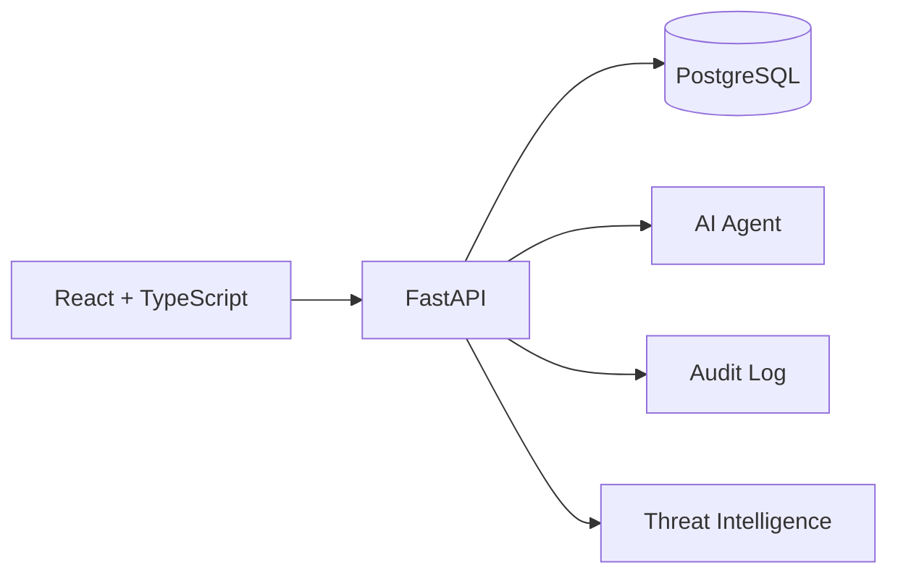

# RabbitHollow

### Deception Intelligence Platform

> Security platform for monitoring, analyzing and managing deception infrastructure.

RabbitHollow je security dashboard pro deception operations. Spojuje honeypoty, honeynet, threat hunting, IOC intelligence, attacker profiling, incident ticketing, security guardrails, audit a AI-assisted workflows do jednoho rozhraní.

Současná podoba projektu vychází z frontend prototypu `rabbithollow-v3_4.html`. Prototyp obsahuje kompletní UI koncept, navigaci a hlavní workflow, přičemž část dat a operací je zatím simulovaná.

## Platforma

| Modul | Účel |
| --- | --- |
| Dashboard | Přehled honeypotů, intrusion, attacker IPs, IOCs, risku a live eventů |
| Honeypot Builder | Konfigurace deception nodes a deployment workflow |
| Honeynet Designer | Topologie, segmentace a isolation controls |
| Breadcrumb Trails | Lures, canarytokens a sledování jejich aktivace |
| Threat Hunting | SPL, KQL, Sigma a SQL workflow |
| IOC Intelligence | Evidence a analýza indicators of compromise |
| Attacker Profiles | Behavioral fingerprints a korelace aktivit |
| AI Cyber Agent | Incident triage, IOC correlation, ticket drafting a security assistance |
| Auto Reports | Threat summaries a reporting workflow |
| IP Activity Tracker | Timeline IP aktivit a korelace s honeypoty |
| Asset Management | Evidence produkčních a decoy assets |
| Security Tickets | Incident tracking, investigation notes a response workflow |
| Security & Guardrails | RBAC, isolation, deployment gates a bezpečnostní policy |
| Audit Log | Append-only audit trail a integrity monitoring |
| Settings | Alerting, threat intelligence a platform configuration |

## Security model

Deception infrastruktura je navržená jako oddělené prostředí s důrazem na isolation a bezpečné workflow.

Klíčové principy:

- deny-by-default egress
- network a workload isolation
- synthetic credentials
- honeytoken policy
- DNS sinkholing
- RBAC
- server-side security gates
- dual-control approval pro high-risk deception nodes
- append-only audit trail
- human review pro AI-assisted security actions

AI workflow v MVP nebude mít přímý shell, firewall ani production deployment access.

## Interface

UI je postavené jako dark security-oriented single-page interface. Vizuální systém používá Space Grotesk pro UI, JetBrains Mono pro technická data a výrazný purple accent.

Součástí původního rozhraní jsou například:

- live event feed
- threat ticker
- risk gauge
- MITRE ATT&CK matrix
- honeynet topology canvas
- global attacker-origin map
- terminal-style configuration preview
- animated stat cards
- command palette
- keyboard shortcuts
- toast notifications

Cílem MVP je zachovat tento vizuální koncept a jeho hlavní workflow **1:1** při postupném nahrazování mock logiky skutečným backendem.

## Architecture

## MVP

MVP je rozdělené do postupných fází od převodu současného frontendu přes backend, persistence a RBAC až po deception management, intelligence, audit, AI a reporting.

Podrobný plán je v [`MVP_PLAN.md`](./MVP_PLAN.md).

## Current status

🚧 **MVP development**

Aktuální základ je frontendový prototype. Deployment, threat feeds, SIEM integrace, API calls, firewall actions a LLM operace jsou zatím reprezentované mock nebo advisory workflow.

Dalším krokem je postupný převod prototypu na skutečnou aplikaci při zachování jeho současného UI.
