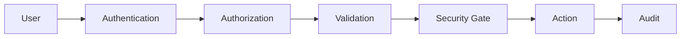

# Security

### RabbitHollow

RabbitHollow pracuje s deception infrastrukturou, security events a AI-assisted workflows. Bezpečnostní model proto musí být součástí architektury, ne pouze UI.

## Principles

- least privilege
- deny-by-default
- server-side authorization
- isolation by design
- synthetic data for deception
- human approval for high-risk actions
- append-only audit
- explicit integration boundaries

## Authentication

Authentication bude řešena backendem. Hesla, pokud budou použita, se ukládají pouze jako bezpečné password hashes.

Session/token credentials nesmí být součástí source code, Git historie ani frontend bundle.

## RBAC

RBAC je security boundary.

Frontend permission checks slouží pouze pro UX. Každá chráněná operace musí být autorizována znovu na backendu.

## Deception isolation

Deception assets nesmí implicitně získat přístup do produkční infrastruktury.

Výchozí síťová politika je deny-by-default. Přístup musí být explicitně povolený a validovaný.

Pro deployment workflow se počítá s:

- network isolation
- workload isolation
- namespace/cgroup isolation tam, kde je relevantní
- omezeným egress
- DNS sinkholing
- oddělením deception a production credentials

## Credentials

Deception prostředí používá synthetic credentials.

Do lure dat, honeytokenů ani seed dat nesmí být vloženy:

- production passwords
- API keys
- private keys
- access tokens
- reálné PII

## Honeytokens

Honeytokens musí být syntetické, jednoznačně sledovatelné a oddělené od produkčních secrets.

Aktivace honeytokenu vytváří security event a může být propojena s IOC, IP activity a attacker profile.

## High-risk deployment

RDP, SMB, Industrial a Kubernetes deception nodes jsou považovány za high-risk.

Deployment musí před provedením projít:

```text
validation → security gate → dual-control approval → action → audit
```

Frontend nesmí být schopen tento proces obejít.

## AI security

AI je advisory vrstva, nikoliv security authority.

V MVP AI:

- nemá přímý shell access
- nemá přímý firewall access
- nemá production deployment access
- nemá přístup k neautorizovaným datům
- nesmí samo provést citlivou security action

AI output musí být rozlišitelný od potvrzené systémové akce.

## Input validation

Všechny externí vstupy musí být validované podle očekávaného schema.

Backend nesmí používat string concatenation pro databázové query.

Query execution v Threat Hunting musí být omezený na povolený query model a datasource.

## Secrets

Secrets patří mimo repository.

Lokální development používá `.env`, které je ignorované přes `.gitignore`. Do repozitáře patří pouze bezpečné `.env.example` hodnoty bez skutečných secrets.

## Audit

Security-sensitive operace vytvářejí audit event.

Audit obsahuje minimálně actor, action, resource, result, timestamp a correlation ID.

Běžný uživatel nesmí audit event upravovat ani mazat.

## Logging

Logy nesmí obsahovat:

- passwords
- tokens
- API keys
- private keys
- session secrets
- zbytečné PII

Chybové response pro klienta nesmí odhalovat interní stack traces.

## Threat model

Hlavní rizika MVP:

| Risk | Control |
| --- | --- |
| Unauthorized access | Authentication + RBAC |
| Privilege escalation | Server-side permission checks |
| Deception escape | Isolation + deny-by-default egress |
| Unsafe deployment | Validation + security gates + dual control |
| Secret leakage | Synthetic data + secret management |
| AI misuse | Human review + restricted capabilities |
| Audit tampering | Append-only design |
| Injection | Validation + parametrized queries |

## Security boundary



Každá vrstva má vlastní odpovědnost. Žádná jednotlivá frontendová kontrola nesmí být jedinou ochranou citlivé operace.

## Reporting vulnerabilities

Bezpečnostní problém v projektu nemá být zveřejňován společně s credentials nebo exploit payloady v běžném issue.

Při práci na lokálním prototypu používej výhradně syntetická data a izolované prostředí.
