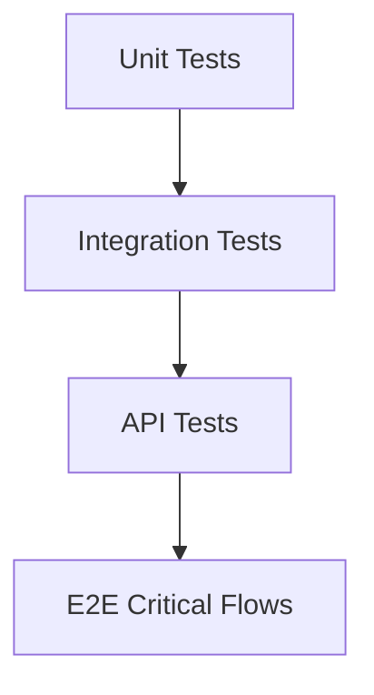

# Testing

### RabbitHollow

Testování se zaměřuje hlavně na security-critical business logic, API contract a workflow, která mohou měnit stav systému.

## Test layers

## Unit tests

Testovat zejména:

- validation
- risk calculation
- permission checks
- security gates
- status transitions
- IOC normalization
- correlation logic
- query validation

## Integration tests

Ověřit spolupráci:

- FastAPI + database
- authentication + RBAC
- honeypot validation + security gate
- event + IOC correlation
- attacker profile aggregation
- ticket + audit event

## API tests

Každý protected endpoint musí mít minimálně:

- authorized request
- unauthorized request
- forbidden request
- invalid input
- expected success response
- expected error response

Security-sensitive endpointy musí testovat také pokus o obejití permission nebo approval workflow.

## Critical workflows

Před MVP release musí být pokryté minimálně:

1. login
2. dashboard data loading
3. create honeypot
4. validate honeypot
5. reject unauthorized deployment
6. approve high-risk deployment
7. create/search IOC
8. correlate IP activity
9. create/update ticket
10. audit sensitive action
11. AI recommendation + human review

## Edge cases

Testovat také:

- empty input
- malformed IP
- invalid IOC type
- duplicate IOC
- expired session
- missing permission
- invalid status transition
- concurrent update
- missing related entity
- malformed query
- oversized request
- unavailable database
- AI timeout/error

## Security tests

Security testy musí ověřit, že:

- frontend permission check nelze použít jako jedinou ochranu
- protected endpoint nejde volat bez authentication
- user nemůže provést action bez permission
- high-risk action nelze provést bez approval
- audit event nelze změnit běžným API
- secrets se nevracejí v response
- invalid input nemůže způsobit injection

## Definition of Done

Test je součástí MVP workflow, pokud chrání business rule nebo security boundary, která by při regresi mohla změnit chování systému.

Test suite musí být spustitelná lokálně i v CI.
